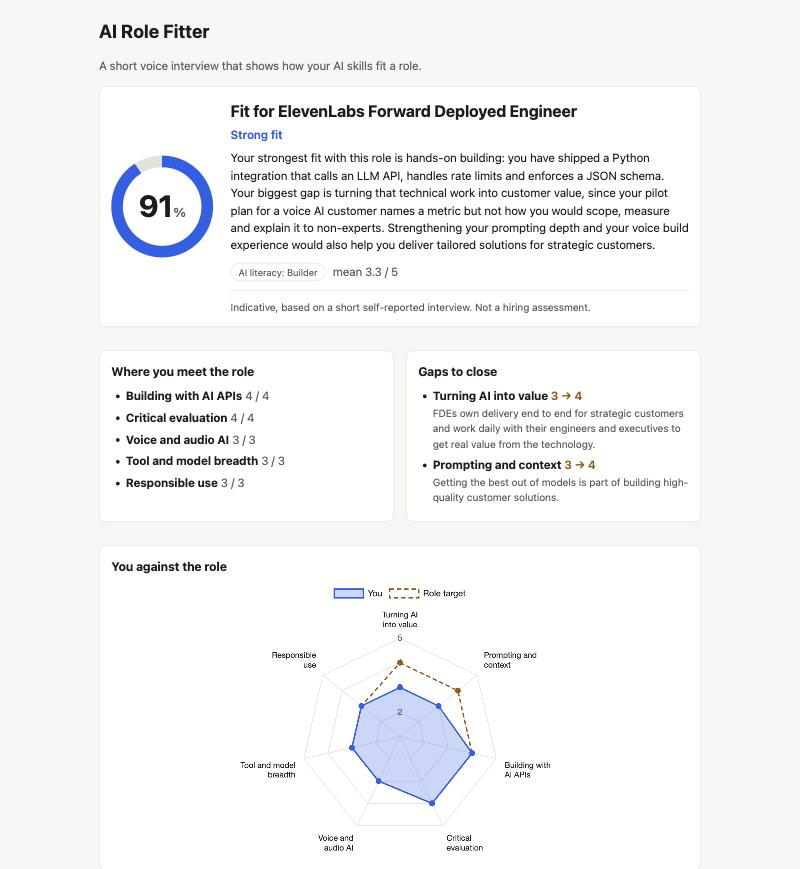
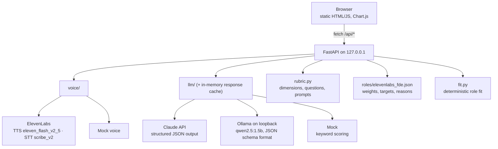

# AI Role Fitter

A short voice interview about how you use AI, scored against the ElevenLabs Forward
Deployed Engineer role: you get a fit percentage, your gaps, and a development plan.



<!-- Screenshot placeholder: add docs/screenshot.png -->

The result is **indicative, for self-development**. It comes from a short self-reported
interview and is not a hiring assessment; the report says so.

## Why I built this

- **Customer framing.** It is scoped like an FDE deployment: *a company scaling its FDE
  team wants candidates and new hires to see how their AI skills map to the role, and
  what to work on first.* See the [solution brief](docs/solution-brief.md).
- **ElevenLabs STT and TTS.** Questions are read aloud with ElevenLabs TTS
  (`eleven_flash_v2_5`) and spoken answers are transcribed with Scribe v2.
- **Enterprise trade-offs.** One config switch moves the LLM step between Claude, a fully
  local model (answers never leave the machine) and a no-network mock, with measured
  latency, cost and accuracy for each.

## Quickstart

Needs macOS or Linux, Python 3.12 and `make`.

```bash
git clone https://github.com/alexnaylor99/ai-role-fitter.git
```

```bash
cd ai-role-fitter && make setup
```

**(a) No keys: mock mode.** Deterministic keyword scoring, no network, no cost.

```bash
LLM_PROVIDER=mock VOICE_PROVIDER=mock make dev
```

Open http://127.0.0.1:8000. Type your answers, or add `?demo=1` to the URL to pre-fill
them. *View sample report* on the start screen shows a real Claude report with no keys.

**(b) Full mode: Claude + ElevenLabs.**

```bash
cp .env.example .env
```

Add `ANTHROPIC_API_KEY` and `ELEVENLABS_API_KEY` to `.env` (use dedicated keys with a
spend limit), then run `make dev`. The default model is `claude-opus-5-5`; set
`CLAUDE_MODEL=claude-haiku-5-5` for the measured figures below. Without an ElevenLabs
key, voice is switched off and answers are typed.

**(c) Local privacy mode: Ollama.** Install [Ollama v0.12.3](https://github.com/ollama/ollama/releases/tag/v0.12.3),
then:

```bash
ollama pull qwen2.5:1.5b
```

Set `LLM_PROVIDER=ollama` in `.env` (or pick **Local** on the start screen) and run
`make dev`. Ollama must stay on loopback; see [SECURITY.md](SECURITY.md#ollama-v0123).

> **Local mode is a privacy option, not the accurate one.** On a 2017 dual-core Intel
> MacBook (8GB) a report takes ~100–115s, and the 1.5B model scores generously: on the
> eval it got 15/21 scores in range and 1/3 fit bands, against Claude's 20/21 and 3/3.
> A customer would run it on a GPU or Apple Silicon, or with a larger local model.

Other commands: `make check` (lint, format, tests, secret scan), `make audit`
(dependency vulnerabilities), `make eval PROVIDER=mock|claude|ollama` (the eval set;
`claude` costs money). For running the live demo, see the [demo runbook](docs/DEMO.md).

## Architecture



Key design decisions:

- **Adapters behind Protocols.** Each external service (`LLMProvider`, `VoiceProvider` in
  [app/contracts.py](app/contracts.py)) is swappable and tested with faked HTTP. That is
  how it would fit into a customer's stack.
- **The LLM scores; Python calculates.** The LLM returns 1–5 scores with evidence,
  validated against a schema. The fit %, band, gaps, mean and level are computed in
  [app/fit.py](app/fit.py) and [app/rubric.py](app/rubric.py): the same scores always
  give the same fit, and the maths can be explained to a customer.
- **Evidence must be real.** Any `evidence_quote` that isn't verbatim from the
  transcript is blanked before the report is shown.
- **The role is data, not code.** A new role is a new JSON file: configure, don't rebuild.
- **Reliability per provider.** Claude uses structured outputs, server-side refusal
  fallbacks and one retry if validation fails; Ollama uses its `format` JSON schema, a
  repair step and one retry. Local and mock modes pick the follow-up question with an
  instant rule instead of a slow LLM call.
- **No frontend build step.** Fewer moving parts for a demo and a reviewer.

## How role fit works

The interview covers 7 dimensions, one question each, plus one adaptive follow-up aimed
at the role's most important dimension where your evidence is thinnest. Each dimension
is scored 1 (Unaware) to 5 (Leading). The role profile,
[app/roles/elevenlabs_fde.json](app/roles/elevenlabs_fde.json), is built from the
published ElevenLabs FDE job spec:

| Dimension | Weight | Target | Why it matters for the role |
|---|---|---|---|
| Building with AI APIs | 3 | 4 | Python, software architecture and API integration; designing and shipping tailored integrations. |
| Turning AI into value | 3 | 4 | Owning delivery end to end for strategic customers, with their engineers and executives. |
| Voice and audio AI | 2 | 3 | The product is voice and audio AI; the spec asks for enthusiasm for audio AI and accessibility. |
| Prompting and context | 2 | 4 | Getting the best out of models when building customer solutions. |
| Critical evaluation | 2 | 4 | First-principles problem solving; reliable solutions in high-stakes settings. |
| Responsible use | 1 | 3 | Enterprise customers expect careful handling of their data. |
| Tool and model breadth | 1 | 3 | Knowing the landscape customers compare against. |

**The formula, in plain English.** For each dimension, your fit is your score divided by
the target, capped at 100% (beating the target earns no extra credit). The fit % is the
weighted average of those, rounded. A gap is how far you are below the target; gap ×
weight is its priority, which orders the gaps and the development plan.

| Fit % | Band |
|---|---|
| 85 and above | Strong fit |
| 70–84 | Good fit |
| 50–69 | Developing fit |
| Below 50 | Early stage |

**Add a role by adding a JSON file** with the same shape (7 requirements, weight 1–3,
target 1–5, a reason each) and pointing `ROLE_PROFILE` at it. The app validates it at
startup and refuses to start with a clear message if it is invalid.

## Privacy and security

| Mode | Your answers (text) | Your voice recordings |
|---|---|---|
| **Claude** | Anthropic API | ElevenLabs Scribe (if voice is on) |
| **Local** | Stay on this machine | ElevenLabs Scribe (if voice is on) |
| **Mock** | Stay on this machine | Nowhere with `VOICE_PROVIDER=mock` or `none`; ElevenLabs Scribe if an ElevenLabs key is set |

- **Keys** are read from `.env` on the server only; they are never sent to the browser or
  logged. `.env` is git-ignored.
- **Data** stays in server memory. Nothing is written to disk unless `SAVE_SESSIONS=true`
  (git-ignored `sessions/`). `tts_cache/` holds audio for the fixed questions only.
- **Local only.** The server binds to `127.0.0.1`, refuses foreign `Host` headers and
  cross-site writes, and the Ollama URL must be an exact loopback host.
- **LLM output is untrusted:** rendered with `textContent` only, under a strict CSP.
- **Secret scanning:** `detect-secrets` as a pre-commit hook, `gitleaks` over the full
  history in CI. Dependencies are pinned in `requirements.lock`, checked by `pip-audit`
  in CI, and CI actions are pinned to commit SHAs.

The threat model and full data table are in [SECURITY.md](SECURITY.md).

## Evaluation

- **165 tests** (pytest): role-fit maths (worked examples, band boundaries, beating the
  target), level calculation, role profile validation, the loopback guard, every API
  route, and each provider against faked HTTP (`respx`). No test makes a network call.
- **CI** runs ruff, pytest (mock only, no keys), `pip-audit` and `gitleaks`.
- **Eval set:** 3 fictional personas (novice, practitioner, expert FDE) in
  [tests/fixtures/personas/](tests/fixtures/personas/), each with an expected score range
  per dimension and an expected fit band. `make eval PROVIDER=…` prints both, plus
  latency.

Latest results:

| Provider | Scores in range | Fit bands correct | Notes |
|---|---|---|---|
| Claude (`claude-haiku-5-5`) | 20/21 | 3/3 | |
| Local (`qwen2.5:1.5b`) | 15/21 | 1/3 | Generous: novice at 63% (expected under 50%), practitioner at 100% (Claude: 83%) |
| Mock (keyword rules) | 16/21 | 2/3 | A no-network stand-in, not a real assessor |

## Latency and cost

Measured on a 2017 dual-core Intel MacBook (8GB).

| Mode | Report time | Follow-up question | Cost per interview |
|---|---|---|---|
| Claude (`claude-haiku-5-5`) | ~10–16s | Written by Claude | ~$0.002 |
| Local (`qwen2.5:1.5b`, Ollama 0.12.3) | ~100–115s | Rule-based, instant | $0 (runs on the laptop) |
| Mock | Instant | Rule-based, instant | $0 |

How cost is kept down:
- **Claude prompt caching** on the stable system prompt (rubric + role, ~2.4k tokens),
  read at 10% of the input price within 5 minutes. Verified: the sample report read
  2,394 cached tokens.
- **In-memory response cache:** the same answers are never assessed twice (instant and
  free on a repeat run; never written to disk).
- **ElevenLabs:** audio for the 7 fixed questions is cached in `tts_cache/`, so after the
  first run only the follow-up question and transcription use credits.

The report footer shows timings, provider, model, cache use and estimated cost. The
default `claude-opus-5-5` is not measured here and costs more per token than Haiku.

## Roadmap

- Run the whole interview on the ElevenLabs Agents Platform for a real-time conversation.
- More role profiles and a role picker, plus "best-fit role" across several roles.
- Generate a role profile from a pasted job description (LLM-drafted, human-approved).
- Team view: aggregate results across a team for its lead.
- Multilingual interviews (Scribe and multilingual TTS).
- Re-assessment over time, showing progress towards the role.
